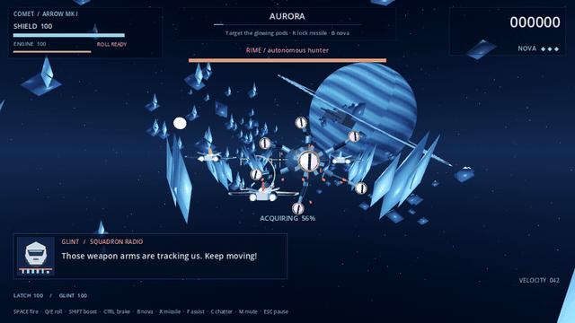

# Foxlike: Asterion Flight

An original, complete three-mission **3D arcade flight campaign** in the Project Barrel Roll setting. Fly Mara “COMET” Venn's Arrow Mk I with LATCH and GLINT, break a coastal blockade, chase a signal through an ice field, and destroy the command carrier over Terminus.

Built for **Godot 4.7.2 stable**, using the Compatibility renderer. All ships, environments and effects are procedural 3D geometry. Music and effects are original synthesis. No external asset service, account, API key or network connection is needed to play a downloaded build.



[Higher-resolution animation clip](docs/previews/flight-animation.mp4) · [Viridia screenshot](docs/previews/02-flight-0.png) · [Terminus boss screenshot](docs/previews/03-boss-2.png)

## Play

**Windows:** open the latest successful [Build playable game workflow](https://github.com/eyehaveewe-cyber/Foxlike/actions/workflows/build.yml), download **Foxlike-playable-builds**, extract `Foxlike-windows.zip`, then launch `Foxlike.exe`. Keep the `.pck` beside it. Godot is not needed for the exported game.

**From source:** open `project.godot` in Godot 4.7.2 stable and press **F6 on `scenes/main.tscn`**, or **F5** to run the project. No editor plugins or package installation required.

**Browser:** the workflow also produces `Foxlike-web.zip`. Serve its extracted directory over HTTP, such as `python -m http.server 8000`, then visit `http://localhost:8000`. The web build uses WebGL 2 and single-threaded WebAssembly. Click the game to enable audio. Optional GitHub Pages publishing is configured but requires the repository's Pages setting and `ENABLE_PAGES` variable; no live site is implied.

See [running and packaging](docs/RUNNING.md) for detailed export instructions.

## The game

- **Viridia — The coast is burning:** sunset coastal city, formation attacks, debris slalom, and the Warden blockade frigate.
- **Aurora — Ghosts in the ice:** crystalline asteroid corridor, ringed planet, crossing interceptors, and RIME's six articulated weapon tentacles. Destroyed arms physically collapse.
- **Terminus — The last light:** orbital shipyard trench, reinforcements, telegraphed lance strikes, and the Sovereign command carrier.

Each route lasts about 90–105 seconds before its boss. Boss duration depends on aim and weapon use; a first full campaign is roughly 8–12 minutes. Each mission restores the ship and ammunition. Defeat offers a mission retry. Completing missions saves unlocks, scores and difficulty-specific records; the final mission closes the story.

The flight rig banks and pitches into movement, flaps respond to throttle, thrusters lengthen under boost, and barrel rolls deflect shots. Boss cores rotate, carrier doors move, weapon arms articulate and collapse, and explosions throw spinning debris through expanding shockwaves. The soundtrack has six distinct mission/boss arrangements.

Three difficulties adjust damage and, on Cadet, target durability and aim assistance. Mission selection unlocks as the campaign advances. Scores reward kills, chains, rings, surviving wingmen, remaining shields and weapon-pod destruction.

## Controls

| Action | Keyboard / mouse | Controller |
|---|---|---|
| Steer | WASD / arrows, or move the mouse | Left stick |
| Twin lasers | Space / left click | Right trigger |
| Barrel roll | Q / E | A |
| Boost | Hold Shift | Right bumper |
| Brake | Hold Ctrl | Left bumper |
| Homing missile | R / right click after lock | X |
| Nova bomb | B | B |
| Wingman crossfire | F | Y |
| Pause / resume | Escape | Start |
| Mute sound | M | Pause menu |
| Cut / resume chatter | C | — |
| Fullscreen | F11 | — |

Aim at a target until the lock completes, then fire a homing missile. Missiles recharge in 2.5 seconds; wingman crossfire recharges in 24 seconds. Nova bombs are limited. **Gold rings repair shields; collecting three upgrades the twin lasers.** Green crosses repair damage, red crosses replenish a nova. Roll through red shots, steer around debris, and move sideways out of the Sovereign's marked lance lane.

Mouse movement takes over steering; pressing a steering key or moving the controller stick returns to that input. Release boost after exhausting the engine to rearm it. Use Tab/arrow keys and Enter to navigate menus.

## Development and verification

```bash
godot --headless --path . --editor --import --quit
godot --headless --path . --script tests/game_smoke.gd -- --test-save
python tools/package_release.py --godot godot
```

The integration suite exercises real scene state, keyboard input, moving projectiles, lock/missile hits, rolls, bombs, pickups, all three mission routes and boss/result transitions, defeat/retry, and save validation. It uses a separate save file. It does **not** substitute for human playtesting or demonstrate difficulty balance; boss-death cases reduce boss health to make transitions deterministic.

See [verification evidence](docs/VERIFICATION.md), [progress](PROGRESS.md), [design](docs/DESIGN.md), and [source provenance](docs/SOURCES.md). The [design handoff DOCX](docs/Foxlike_Design_and_Handoff.docx) records the brief and implementation choices.

This is a compact first complete game, with room for later refinement. It is an on-rails campaign, not an all-range dogfight simulation. It has no multiplayer, voice acting, rebinding interface or touch controls. Controller bindings are implemented; physical controller testing and Windows hardware performance remain to be checked.

## Project structure

| File | Responsibility |
|---|---|
| `scripts/flight_game.gd` | Flight, combat, campaign, encounters, saves |
| `scripts/ship_model.gd` | Procedural airframes and animation rigs |
| `scripts/flight_world.gd` | Lit worlds and bounded scenery recycling |
| `scripts/flight_hud.gd` | Menu, briefing, cockpit, radio, debrief, ending |
| `scripts/flight_overlay.gd` | Projected reticle and target feedback |
| `scripts/flight_effects.gd` | Capped particles and shockwaves |
| `scripts/flight_audio.gd` | Music, sound pool and volume |
| `assets/audio/generate_audio.py` | Reproducible original soundtrack/effects |
| `tests/` | Integration and rendered evidence harnesses |
| `tools/package_release.py` | Repeatable Windows and Web packages |

Star Fox is a gameplay reference only. This project does not include Nintendo characters, names, models, music or other game assets. Project Barrel Roll's Asterion setting and procedural design language are used with the owner's explicit permission. No project-wide redistribution license is selected in this initial delivery.
