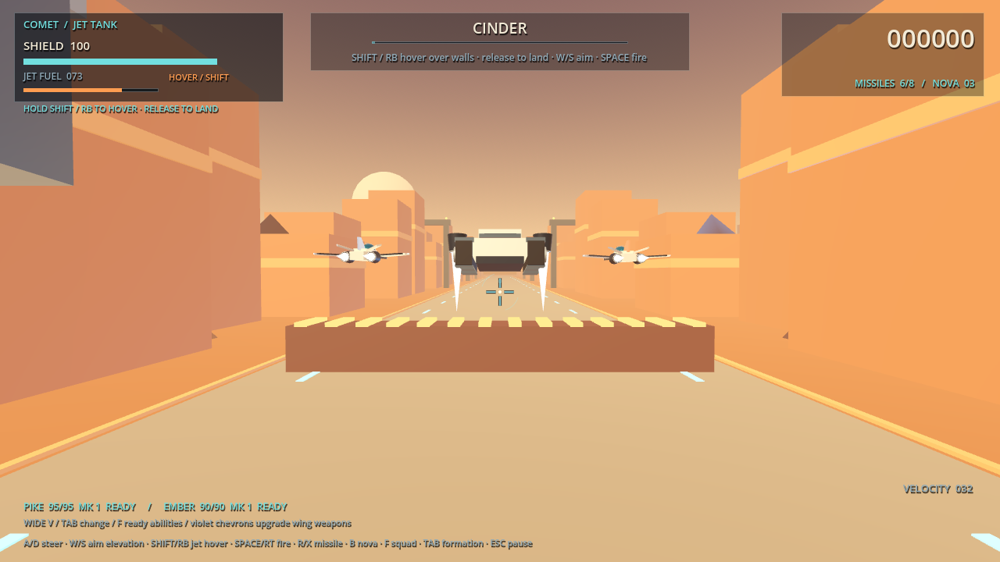

# Foxlike: Asterion Flight

A six-mission **3D arcade campaign** in the Project Barrel Roll setting. Fly Mara “COMET” Venn's Arrow Mk I with two selectable companions, drive the jet-assisted Jackal tank, defend the Dragonfly carrier in an open arena, and face a separate boss on every mission.

Built for **Godot 4.7.2 stable**, using the Compatibility renderer. All ships, environments and effects are procedural 3D geometry. Music combines original Foxlike synthesis with three MBean1 score excerpts rendered through MBean1's own audio engine; effects are synthesized. No external asset service, account, API key or network connection is needed to play a downloaded build.



[Tank hover and landing](docs/previews/tank-hover.mp4) · [Arena turnaround](docs/previews/arena-turn.mp4) · [Dragonfly defense](docs/previews/carrier-defense.png) · [Six-mission menu](docs/previews/six-mission-menu.png)

## Viridia Orbit peaceful hub

Choose **Viridia Orbit / Peaceful Hub** on the current flight deck. Your ship begins stationary at the orbital observatory above the first planet. Fly between its two habitat rings and docking piers, coast through the outer asteroid drift, or stay parked while the planet and clouds turn below.

Viridia has procedural oceans, continents, polar caps, night lights, a separate cloud layer and a blue atmospheric limb. The station has solar fields, lit windows, observation rings and safe hull clearance. Asteroid visitors gradually reveal beyond the station, orbit slowly, yield near the ship, and remain limited to 24 active objects. This is an artistic, scaled orbit room rather than an astronomical N-body calculation.

**W/S** thrust forward/back, **A/D** strafe, **Q/E** descend/rise, and **arrows or RMB-drag** look. **Shift** boosts; **Space** brakes to hover; **H** toggles automatic station keeping versus momentum drift. **F2** cycles chase/orbit/observatory views, **F3** hides the interface, **B** toggles asteroid visitors, **J** admits a visitor ahead, **Home** restores the station berth, **M** toggles the ambient sound, and **Escape** opens options. The options include a 0–8× orbital-time control that leaves ship handling unchanged. The hub has no combat, mission timer or failure condition.

Controller: left stick translates, right stick looks, bumpers descend/rise, RT boosts, LT brakes, Y toggles assist, X changes view, Back hides the interface, B returns to the berth and Start opens options. Physical controller testing remains open.

[Station arrival](docs/previews/orbit-station.png) · [Observatory and planet](docs/previews/orbit-observatory.png) · [Planetary panorama](docs/previews/orbit-planet.png) · [Orbit tour](docs/previews/viridia-orbit.mp4)

## Phase One practice duel

Choose **Practice Duel** beside Continue Flight. Fly nose-directed spatial combat against one observed opponent, use a solid anchor block to break sight, and counter a missed firing pass. The briefing compares **600 × 600 × 76** and **640 × 640 × 160** arenas, **pitch hold** and **gradual leveling**, and reduced camera motion. F5 resets; Escape/Start pauses. F3/F8 provide optional local review telemetry.

The practice implementation follows the full Phase One guide. It uses shared player/AI limits and world-space weapons. **Human completion gates and the final arena/control selection remain open.** There are 38 new duel regressions in addition to the existing campaign suites; Windows and Web exports build. See [implementation and acceptance record](docs/PHASE_01_IMPLEMENTATION.md).

[Native arranged duel recording](docs/previews/phase1-duel.mp4) · [Practice briefing](docs/previews/phase1-briefing.png) · [Cover and last-seen contact](docs/previews/phase1-cover.png) · [Matching source-stamped trace](docs/evidence/phase1-arranged-trace.json)

## Download the editable Godot project

**[Download the complete source ZIP](https://github.com/eyehaveewe-cyber/Foxlike/archive/refs/heads/main.zip)**, extract it, then import **`Foxlike-main/project.godot`** in Godot 4.7.2 stable. Press **F5** to play or edit the scenes and scripts. The ZIP includes the scene, GDScript source, procedural ship models, audio assets, and export presets.

The `project.godot` file is at the repository root. On GitHub you can also use **Code → Download ZIP**. The Windows executable package is a separate download.

For a smaller source-only bundle, each new build also provides a **Foxlike-Godot-source** Actions artifact containing `Foxlike-source.zip`. Recreate that package with `python tools/package_source.py`; no Godot installation is needed for packaging.

## Play

**Windows:** open the latest successful [Build playable game workflow](https://github.com/eyehaveewe-cyber/Foxlike/actions/workflows/build.yml), download **Foxlike-playable-builds**, extract `Foxlike-windows.zip`, then launch `Foxlike.exe`. Keep the `.pck` beside it. Godot is not needed for the exported game.

**From source:** open `project.godot` in Godot 4.7.2 stable and press **F6 on `scenes/main.tscn`**, or **F5** to run the project. No editor plugins or package installation required.

**Browser:** the workflow also produces `Foxlike-web.zip`. Serve its extracted directory over HTTP, such as `python -m http.server 8000`, then visit `http://localhost:8000`. The web build uses WebGL 2 and single-threaded WebAssembly. Click the game to enable audio. Optional GitHub Pages publishing is configured but requires the repository's Pages setting and `ENABLE_PAGES` variable; no live site is implied.

See [running and packaging](docs/RUNNING.md) for detailed export instructions.

## The game

- **Viridia — The coast is burning:** sunset coastal city, formation attacks, debris slalom, and the Warden blockade frigate.
- **Aurora — Ghosts in the ice:** crystalline asteroid corridor, ringed planet, crossing interceptors, and RIME's six articulated weapon tentacles. Destroyed arms physically collapse.
- **Terminus — The last light:** orbital shipyard trench, reinforcements, telegraphed lance strikes, and the Sovereign command carrier.
- **Cinder — Fire beneath the tracks:** drive the Jackal tank through foundries, use finite-fuel jet packs to hover over barriers, and dismantle Iron Maw's mortars and siege crawler core.
- **Anchorage — Hold the circle:** fly freely around the Dragonfly, intercept its attackers, and destroy the Harrow carrier hunter before the friendly carrier loses its hull. Radar and perimeter beacons help you keep your bearings.
- **Tempest — Beyond the storm:** thread storm conduits, evade lightning lanes, and strip the Crown storm fortress's four pylons before attacking its heart.

Mission approaches last 88–110 seconds before the boss; boss duration depends on aim and weapon use. Each mission restores the vehicle and ammunition. Defeat offers a mission retry. Completing missions saves unlocks, scores and difficulty-specific records; Tempest closes the expanded campaign. Existing saves that cleared Terminus unlock Cinder automatically.

The flight rig banks and pitches into movement, flaps respond to throttle, thrusters lengthen under boost, and barrel rolls deflect shots. Boss cores rotate, carrier doors move, weapon arms articulate and collapse, and explosions throw spinning debris through expanding shockwaves. Every boss has individually damageable weapon systems with their own health. Destroying a system removes its shots; until all systems are down, the core takes only 8% damage. On Standard, Warden has a 260-health core and two 65-health cannons. The mission soundtrack uses three developed excerpts from MBean1's *The Bone Lantern Ballroom*, alongside Foxlike's original boss music. See [asset provenance](docs/ASSET_IMPORTS.md).

Three difficulties adjust damage and, on Cadet, target durability and aim assistance. Mission selection unlocks as the campaign advances. Scores reward kills, chains, rings, surviving wingmen, remaining shields and weapon-pod destruction.

## Companions and formations

Choose two distinct pilots in the main screen's companion loadout. Equip LEFT or RIGHT; choosing an already equipped pilot swaps slots. The main screen shows health, laser interval and ability cooldown, with the unlock condition on locked pilots. Loadout and formation persist in your save. Existing clear records migrate automatically.

| Pilot | Role | Health | Laser interval | Ability cooldown | Unlock |
|---|---|---:|---:|---:|---|
| Latch | Flies ahead to intercept incoming bolts | 110 | 0.95s | 9s | Starter |
| Glint | Rapid laser fire and six-shot bursts | 75 | 0.28s | 7s | Starter |
| Pike | Homing missiles | 95 | 0.90s | 11s | Clear Viridia |
| Ember | Traveling Nova with a local area blast | 90 | 1.20s | 22s | Clear Aurora |
| Bastion | Heavy bodyguard with frequent interception | 165 | 1.40s | 4.5s | Clear Terminus |

**Tab**, or controller **D-pad Up**, cycles Wide V, Spearhead and Close Guard during flight. The main screen also has a formation selector. The ships fly into their new positions. Bodyguards anticipate bolts aimed at the player, dash ahead, and physically absorb damage using their own health. They cannot stop every attack, and they withdraw when their shields reach zero.

Companions automatically shoot forward targets and use ready offensive abilities. **F / controller Y** commands any currently ready abilities; it cannot bypass their individual cooldowns. A guard commanded early takes position in front. Nova blasts damage nearby enemies and destroy nearby hostile bolts; they do not spend the player's Nova inventory.

**Violet chevron pickups** upgrade both active companions, up to Mk III. Each level adds 40% of base weapon damage, 22% of base firing rate and 18% of base ability recharge rate. A pickup also restores 10 companion health and removes three seconds of current ability cooldown. Pickups appear in authored supply waves and every fifth kill. Withdrawn companions remain out until mission refit, which restores health and resets temporary weapon upgrades.

[Main-screen roster](docs/previews/companion-roster.png) · [Spearhead formation](docs/previews/squadron-spearhead.png) · [Specialist weapons](docs/previews/squadron-weapons.png)

## Controls

| Action | Keyboard / mouse | Controller |
|---|---|---|
| Rail flight steering | WASD / arrows, or move the mouse | Left stick |
| Twin lasers | Space / left click | Right trigger |
| Barrel roll | Q / E | A |
| Flight boost / tank jet packs | Hold Shift | Hold right bumper |
| Tank movement / gun aim | A/D move sideways; W/S aim vertically | Left stick horizontal / vertical |
| Arena turn / altitude | A/D turn; W/S climb or descend | Left stick horizontal / vertical |
| Rail-only in-place somersault | Hold Shift, tap A / Left | Hold RB, flick stick left |
| Rail-only long forward loop | Hold Shift, tap S / Down | Hold RB, flick stick down |
| Rail-only climbing corkscrew | Hold Shift, tap D / Right | Hold RB, flick stick right |
| Brake | Hold Ctrl | Left bumper |
| Homing missile | R / right click after lock | X |
| Nova bomb | B | B |
| Ready companion abilities | F | Y |
| Cycle formation | Tab | D-pad Up |
| Pause / resume | Escape | Start |
| Mute sound | M | Pause menu |
| Cut / resume chatter | C | — |
| Fullscreen | F11 | — |

Aim at a target until the lock completes, then fire a homing missile. Start each mission with **six missiles**, carry up to **eight**, and wait 2.5 seconds between shots. The missile explodes across an **18-unit radius** on impact, damaging nearby enemies and clearing hostile bolts. Cyan ammo crates add three missiles; green repair supplies restore shields and add two. Companion abilities use their own cooldowns and do not spend player ammunition. Nova bombs are also limited.

**Gold rings repair shields; every third ring upgrades the twin lasers.** Red crosses replenish a Nova. Pickup detection follows the relative movement of both vehicle and pickup, so a fast crossing between frames still registers once. The HUD immediately displays the collected item and reward. Roll through red shots, steer around debris, and move sideways out of a marked lance lane.

In the rail flight missions, boost maneuvers each cost 30 engine energy and share a four-second cooldown from activation. Hold boost first, then tap the direction. A held direction does not repeat the move. The compact somersault takes 1.25 seconds; the long loop surges forward, completes a vertical loop, and returns to flight depth in 2.65 seconds. The corkscrew climbs to a forward boosted position in 1.8 seconds, then eases speed and position back to cruise over 1.5 seconds. Release boost after a maneuver to rearm ordinary boost. Steering resumes when the path finishes; Q/E barrel rolls cannot overlap it. Somersaults suspend forward lasers and missile locking during the flip. These maneuvers move the actual collision position and do not add barrel-roll invulnerability. Near screen edges the large paths ease toward a safe center before looping.

[Actual maneuver animation](docs/previews/boost-maneuvers.gif)

In Cinder, hold Shift / RB to jump and sustain hover, release to land, and recharge fuel on the ground. After exhaustion, release and press again to rearm the jets. W/S changes gun aim rather than tank height. The tank cannot barrel-roll or perform flight stunts.

In Anchorage, A/D changes world heading and W/S changes altitude. The carrier and attackers occupy persistent arena positions; radar shows your heading and their relative locations. Approaching the outer rim while heading outward triggers a **2.4-second climbing turnaround**, slows the craft, and returns control facing inward. This move grants no invulnerability. Boost-direction stunts are disabled in the arena.

Mouse movement takes over steering in rail flight; pressing a steering key or moving the controller stick returns to that input. Release boost after exhausting the engine to rearm it. Use Tab/arrow keys and Enter to navigate menus.

## Development and verification

```bash
godot --headless --path . --import
godot --headless --path . --script tests/game_smoke.gd -- --test-save
godot --headless --path . --script tests/squadron_smoke.gd -- --test-save
godot --headless --path . --script tests/combat_revision_smoke.gd -- --test-save
godot --headless --path . --script tests/expansion_smoke.gd -- --test-save
python tools/package_release.py --godot godot
```

The four native integration suites pass **197 assertions**: 74 campaign, 35 squadron, 38 combat revision and 50 expansion checks. They exercise real scene state and input, swept pickup collection, ammunition and area damage, boss parts, tank hover/barrier collision, arena navigation and carrier damage, all six boss/result paths, retries and save migration. They use a separate save file. They do **not** substitute for human playtesting or demonstrate difficulty balance; boss-death cases reduce boss health to make transitions deterministic.

See [playtest resolutions](docs/PLAYTEST_RESOLUTION.md), [verification evidence](docs/VERIFICATION.md), [progress](PROGRESS.md), [design](docs/DESIGN.md), and [source provenance](docs/SOURCES.md). The [design handoff DOCX](docs/Foxlike_Design_and_Handoff.docx) records the brief and implementation choices.

This is a compact arcade campaign combining rail flight, a tank mission and one free-flight defense arena. The expansion has native rendered evidence and successful Windows/Web exports. The local Chromium runtime check is blocked before the menu; see the dated verification record. It has no multiplayer, voice acting, rebinding interface or touch controls. Controller bindings are implemented; physical controller testing and Windows hardware performance remain to be checked.

## Project structure

| File | Responsibility |
|---|---|
| `scripts/flight_game.gd` | Flight, combat, campaign, encounters, saves |
| `scripts/flight_campaign.gd` | Six mission definitions shared by menus and progression |
| `scripts/flight_tank.gd` | Jet-pack fuel, hover, gravity and ground recharge |
| `scripts/flight_arena.gd` | World navigation, arena frame and boundary turnaround |
| `scripts/arena_carrier.gd` | Adapted Project Barrel Roll Dragonfly hull and damage feedback |
| `scripts/flight_squadron.gd` | Companion roster, unlock/save migration, formation offsets and ability stats |
| `scripts/flight_maneuver.gd` | Timed somersault, long loop, corkscrew and recovery paths |
| `scripts/ship_model.gd` | Procedural airframes and animation rigs |
| `scripts/flight_world.gd` | Lit worlds and bounded scenery recycling |
| `scripts/flight_hud.gd` | Menu, briefing, cockpit, radio, debrief, ending |
| `scripts/flight_overlay.gd` | Projected reticle and target feedback |
| `scripts/flight_effects.gd` | Capped particles and shockwaves |
| `scripts/flight_audio.gd` | Music, sound pool and volume |
| `assets/audio/generate_audio.py` | Reproducible original Foxlike soundtrack/effects |
| `assets/audio/mbean/` | MBean1 score, pinned renderer, loop renders and regeneration script |
| `tests/` | Integration and rendered evidence harnesses |
| `tools/package_release.py` | Repeatable Windows and Web packages |

Star Fox is a gameplay reference only. This project does not include Nintendo characters, names, models, music or other game assets. Project Barrel Roll's Asterion setting and procedural design language are used with the owner's explicit permission. No project-wide redistribution license is selected in this initial delivery.

### Orbital hub momentum update

Press **I** or use the options menu to cut/restart the engines. Cutoff disables thrust, hover damping and powered braking; attitude control remains available, and existing velocity survives turns and boost release. Restart engines before using Space to brake. H still toggles powered hover assistance. The outer-room safety arrest and harmless proximity stops remain active.

Asteroids now integrate velocity under scaled planetary tidal gravity and rotating-frame forces, with mass-based rock collision impulses and station rebounds. They no longer follow scripted circles or freeze near the ship. This is a local co-orbiting approximation, not a full solar-system simulation. The station turns slowly at the planet surface rotation rate; its collision volumes rotate with its meshes. Orbital time controls both.

### Orbital light lance

Aim the ship nose at a visible asteroid within 700 m. Press **G / left mouse / controller A** to latch it, then press again to fling. The glowing tether reels the real asteroid toward a stand-off point using a damped spring. Hold for two seconds to charge the fantasy launch from 120 to 320 m/s; ship velocity and part of the asteroid swing velocity carry into the throw. **R** drops the tether without a launch impulse. Solid station cover blocks acquisition and breaks tethers. Returning home, disabling visitors or losing the target releases it safely. The lance works with engines off. Rocks retain ordinary gravity, collisions and momentum after release; the station remains indestructible.
