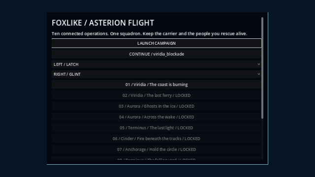

# Foxlike: Asterion Flight

A ten-operation **3D arcade flight campaign** in the Project Barrel Roll setting. Fly COMET’s Arrow with two independent companions, protect the evacuation ferry, intercept Aurora’s courier, drive Jackal through Cinder, repair Dragonfly, stabilize a failing vessel, and defeat Crown before flying home.

Built for **Godot 4.7.2 stable** with the Compatibility renderer. The normal entry is `scenes/main.tscn`. Models and environments are procedural. **Ten distinct MBean1 mission themes and six boss cues** play locally; editable scores and the pinned renderer are included. No account or network connection is needed to play an extracted build.

[Download editable source](https://github.com/eyehaveewe-cyber/Foxlike/archive/refs/heads/main.zip) · [Running and exports](docs/RUNNING.md) · [Expanded campaign implementation](docs/EXPANDED_CAMPAIGN.md) · [Verification](docs/VERIFICATION.md)



## Play

Import the root `project.godot` in Godot 4.7.2 and press F5. For Windows, download the successful **Build playable game** workflow’s **Foxlike-playable-builds** artifact, extract `Foxlike-windows.zip`, and keep `Foxlike.exe` beside `Foxlike.pck`. Serve the Web ZIP over HTTP, for example `python -m http.server 8000`; click the game to enable audio.

The flight deck offers Launch Campaign, Continue, available operation replays, companion selection, Practice Duel, Planet Orbits and settings. The compact six-mission version is preserved in [its historical record](COMPACT_CAMPAIGN.md) and an excluded regression fixture; the normal deck uses the expanded campaign.

## Operations and continuity

1. **Viridia: The coast is burning** — clear the harbor; disabling Warden’s crossing cannon opens evacuation while the frigate remains active.
2. **Viridia: The last ferry** — protect the same required lead ferry across two sectors and a sheltered transfer. Damage slows it; the second transport is optional.
3. **Aurora: Ghosts in the ice** — use low, middle and high routes, disable RIME’s moving arms and retrieve the relay location.
4. **Aurora: Across the wake** — counter Shrike’s high pass and disable the courier’s separate drive before its departure.
5. **Terminus: The last light** — choose Sovereign’s bay, drive, antenna or lance; cover extraction and escape. Authored drive overstrain remains separate from carrier hull damage.
6. **Cinder: Fire beneath the tracks** — clear three ground yards with a finite-fuel hover route and a longer ground alternative; disable walker parts and secure repair cargo.
7. **Anchorage: Hold the circle** — split carrier and delivery defense, resist Rook’s bait, dismantle Harrow, protect optional recovery and escort Dragonfly’s repaired departure.
8. **Terminus: The falling yard** — arrest the overspeed drive, release the coupling and stabilizer, divert the hull and leave through declared wreck corridors.
9. **Tempest: Stormbreak** — disable three corridor controls and break the finite rival flight using cover and forecast weather.
10. **Tempest: Beyond the storm** — choose Crown’s functional vanes or its timed core opening, escape, reassemble and fly the final recovery approach. A late crash keeps Crown defeated.

Versioned saves preserve stable mission identities, checkpoints, score records, companion condition, carrier damage and repair, rescues, rival outcomes and preferences. The explicit old-index mapping retains earned access. Replaying an earlier operation can improve its score without replacing canonical campaign facts or the ending. Malformed and future saves are protected and offer an explicit backup/new-campaign choice.

## Controls

Bindings shown in-game are authoritative and can be changed in settings. Controller button prompts follow the active device. Left stick and right trigger remain steering and firing axes.

| Action | Keyboard / mouse | Controller default |
| --- | --- | --- |
| Steer nose / tank strafe and aim | WASD or arrows; RMB drag | Left stick |
| Fire | Space / LMB | RT |
| Boost / tank hover | Shift | RB |
| Brake | Ctrl | LB |
| Defensive roll | Q / E | A |
| Cycle target | T | Right stick press |
| Homing missile / Nova | R / B | X / B |
| Companion ability | Tap F | Tap Y |
| Attack / protect / cover / regroup | Hold F, then 1 / 2 / 3 / 4 | Hold Y, then D-pad up / right / down / left |
| Formation | Tab | Left stick press |
| Interact / recover information | Hold I at marker | Hold D-pad down |
| Somersault / long loop / corkscrew | Z / X / V | D-pad up / left / right |
| Pause / resume | Escape | Start |
| Mute | M | Keyboard M or settings preference |

Flight stunts cost 30 energy and share a four-second cooldown. Clearance is checked before charging; their actual paths collide with the world and grant no defensive-roll protection. Cinder uses the separate finite-fuel tank controller. Focus loss and controller disconnect pause flight; held controls must be released before resuming.

Choose any two unlocked pilots: Latch and Bastion guard, Glint fires a six-shot burst, Pike launches a missile, and Ember launches an area weapon. They fly under the shared controller, use real forward firing arcs, take their own damage and can withdraw. Tap abilities and held assignments are distinct. Required carrier or cargo loss fails the operation; optional losses change the debrief.

Gold rings repair shields, and every third ring upgrades the lasers through Mk III. Cyan ammunition adds three missiles up to an eight-round cap; green repairs restore shields and add two rounds. Red supplies replenish Nova. Violet supplies upgrade active companions, restore ten health and shorten their cooldown; withdrawn pilots stay out of the sortie. Collection sweeps the actual flight path and awards once.

Pitch hold, camera roll, camera shake, boost FOV and 100%/150% interface size are adjustable. Human playtest instructions do not gate programming, following Jonathan’s October 30 direction. Human feel, physical controller and target Windows performance remain validation work, not claimed test results.

## Asterion planet orbits

Choose **Planet Orbits / Peaceful Hub** on the flight deck for the full **twelve-world selection grid** from Project Barrel Roll. Its original animated system chart is available beside the grid. All worlds are available for peaceful exploration independently of campaign progress.

Every selected planet has a station, its full catalogued moon count, and continuous flight between them. There are **93 physical moons across the twelve sectors**. Fly among terrestrial, ocean, desert, volcanic, storm, ice, carbon, crystal and giant worlds; Boreas, Chronos and Terminus retain their rings. Moon terrain is a procedural spherical surface for orbital approaches, not a landing level.

The room now spans **200 km across**, with distant sphere/detail reduction, cloud culling and station detail cutoffs. **P** opens the planet grid, **N** cycles moon/station waypoints, **F** faces the waypoint and **T** toggles the travel drive. Hold **W** to fly; the drive reaches up to **1,500 m/s** in open space and brakes for close approaches while powered. Planet selection explicitly moves to that world's berth. Moon trips stay in the same continuous 3D space.

**W/S** thrust, **A/D** strafe, **Q/E** descend/rise; **arrows or RMB-drag** look. **Shift** boosts, **Space** brakes, **H** toggles hover assistance and **I** cuts/restarts engines. Engine-off flight preserves momentum while turning, including travel-drive speed. Restart engines to brake. Proximity holds protect the ship from station, asteroid and celestial surfaces.

Aim at a visible asteroid within 700 m and press **G / LMB** to catch it with the light lance. Hold for up to two seconds, then press again to fling with amplified forward, ship and swing momentum. **R** releases gently. Station and planetary cover block the tether. Asteroids integrate scaled gravity, velocity and collision impulses; they appear locally around the pilot even far from the station. **B** toggles visitors; **J** admits one ahead.

**F2** changes view, **F3** hides the interface, **Home** returns to the station, **M** toggles ambient sound and **Escape** opens options. Options also expose moon/drive actions and 0–8× orbital time. Controller bindings remain available; physical controller verification is open. This is a peaceful scaled simulation with no combat timer or failure state.

[Planet grid](docs/previews/orbit-planet-grid.png) · [PBR system chart](docs/previews/orbit-system-chart.png) · [Chronos rings](docs/previews/orbit-chronos.png) · [Moon approach](docs/previews/orbit-moon-approach.png) · [Continuous moon flight](docs/previews/orbit-moon-transfer.mp4) · [Controls and implementation](docs/ORBIT_EXPLORATION.md)

## Practice and verification

Practice Duel retains the two arena-height and pitch experiments, delayed observed contacts, cover, shared movement, local source-stamped traces and restart. [Phase One details](docs/PHASE_01_IMPLEMENTATION.md). The campaign uses reversible defaults while further playtesting remains available.

<!-- native-suite-commands:start -->
```bash
godot --headless --path . --import
godot --headless --path . --script res://tests/operations_smoke.gd -- --test-save
godot --headless --path . --script res://tests/operation_routes.gd -- --test-save
godot --headless --path . --script res://tests/operation_journey_smoke.gd -- --test-save
godot --headless --path . --script res://tests/music_smoke.gd -- --test-save
godot --headless --path . --script res://tests/game_smoke.gd -- --test-save
godot --headless --path . --script res://tests/squadron_smoke.gd -- --test-save
godot --headless --path . --script res://tests/combat_revision_smoke.gd -- --test-save
godot --headless --path . --script res://tests/expansion_smoke.gd -- --test-save
godot --headless --path . --script res://tests/duel_smoke.gd -- --test-save
godot --headless --path . --script res://tests/orbit_smoke.gd -- --test-save
godot --headless --path . --script res://tests/orbit_exploration_smoke.gd -- --test-save
godot --headless --path . --script res://tests/tank_support_smoke.gd -- --test-save
python tools/package_release.py --godot godot
```
<!-- native-suite-commands:end -->

`python tools/package_release.py --godot /path/to/godot` imports, checks and exports Windows and Web. `python tools/package_source.py` builds the editable source ZIP. `python tools/check_documentation.py` checks local links and generated suite lists. [Music source and provenance](docs/ASSET_IMPORTS.md), [asset credits](CREDITS.md), and [original design/handoff](docs/Foxlike_Design_and_Handoff.docx) are included.
